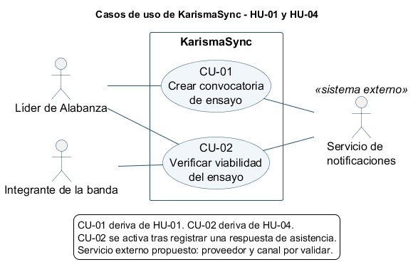
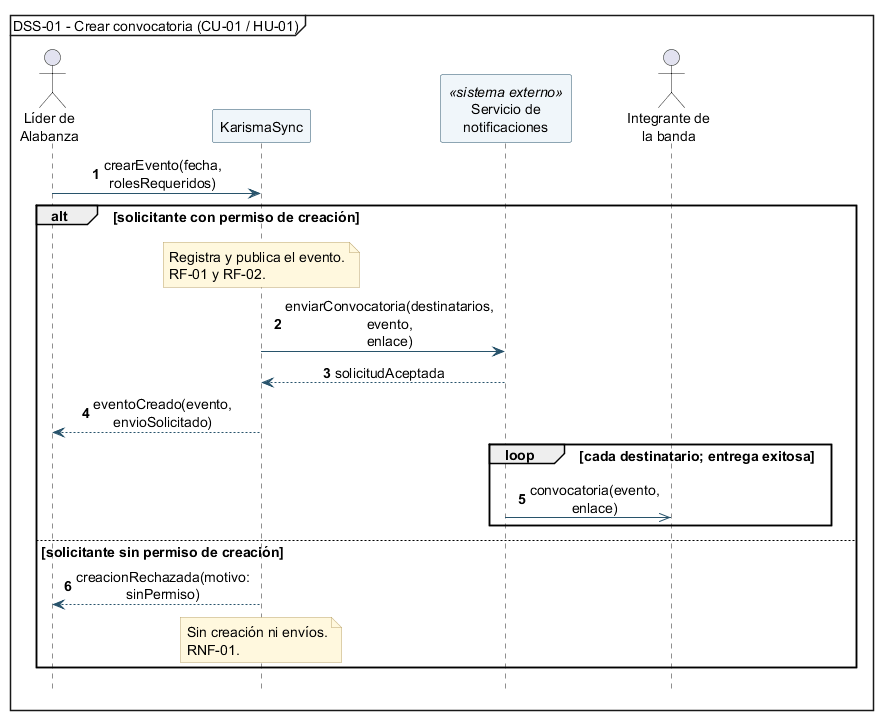
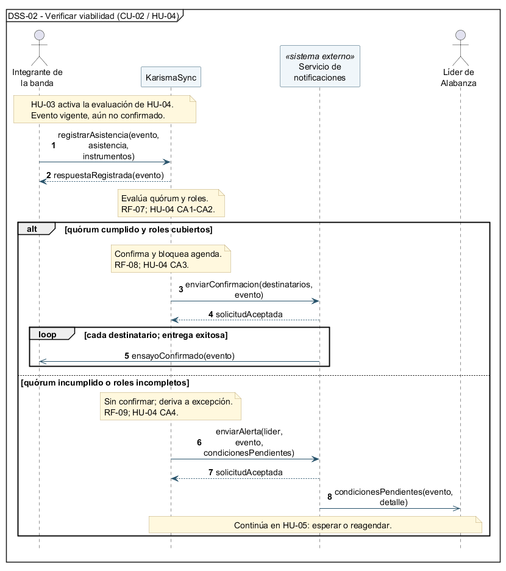

# Casos de uso y secuencias de sistema — KarismaSync

Se representan dos historias del proyecto mediante un diagrama de casos de uso y dos secuencias de sistema con alternativas.

## 1. Historias y trazabilidad

| Historia de origen | Caso de uso | Secuencia | Requisitos |
|---|---|---|---|
| [HU-01: Crear evento de ensayo con roles requeridos](./04-historias-usuario.md#hu-01-crear-evento-de-ensayo-con-roles-requeridos) | [CU-01: Crear convocatoria de ensayo](#cu-01-crear-convocatoria-de-ensayo) | [DSS-01](#dss-01-crear-convocatoria) | RF-01, RF-02, RNF-01, RNF-04 |
| [HU-04: Evaluar automáticamente el quórum y los roles requeridos](./04-historias-usuario.md#hu-04-evaluar-automáticamente-el-quórum-y-los-roles-requeridos) | [CU-02: Verificar viabilidad del ensayo](#cu-02-verificar-viabilidad-del-ensayo) | [DSS-02](#dss-02-verificar-viabilidad) | RF-07, RF-08, RF-09, RNF-04 |

Se eligieron estas historias porque ambas requieren notificaciones: convocar a la banda y comunicar la confirmación o las condiciones pendientes.

## 2. Diagrama de casos de uso

Fuente editable: [casos-de-uso.puml](./diagramas/casos-de-uso.puml).

- **Líder de Alabanza:** crea la convocatoria y recibe alertas.
- **Integrante de la banda:** registra su asistencia y recibe notificaciones; no crea convocatorias.
- **Servicio de notificaciones:** sistema externo que distribuye los mensajes.

Los casos están dentro de KarismaSync y los actores fuera. No se requiere `include` ni `extend`: son objetivos que ocurren en momentos distintos.

## CU-01: Crear convocatoria de ensayo

**Origen:** HU-01, CA1–CA4. **Actor principal:** Líder de Alabanza.

**Condición inicial:** solicitante identificado, banda conocida y datos válidos para el escenario.

**Flujo principal:** el líder envía fecha y roles requeridos. KarismaSync comprueba sus permisos, registra el evento y lo deja disponible. Solicita al servicio externo enviar la convocatoria con su enlace, recibe la aceptación del envío e informa al líder. El servicio entrega las notificaciones a los integrantes.

**Alternativa:** si el solicitante carece del permiso de creación, KarismaSync rechaza la solicitud sin crear el evento ni enviar notificaciones (RNF-01).

### DSS-01: Crear convocatoria

Fuente editable: [dss-01-crear-convocatoria.puml](./diagramas/dss-01-crear-convocatoria.puml).

## CU-02: Verificar viabilidad del ensayo

**Origen:** HU-04, CA1–CA4. **Beneficiario principal:** Líder de Alabanza.

**Condición inicial:** evento vigente, aún no confirmado, con roles requeridos y una regla de evaluación disponible. El integrante registra una respuesta válida.

**Flujo principal:** el registro de asistencia e instrumentos de HU-03 activa la evaluación, siguiendo el [TO-BE](./02-rediseno-to-be.md#actividades-que-cambian-del-as-is-al-to-be). KarismaSync evalúa quórum y roles. Si ambos se cumplen, confirma el ensayo, bloquea la agenda y solicita notificar a la banda mediante el servicio externo.

**Alternativa:** si falta quórum o cobertura de roles, mantiene el ensayo sin confirmar y solicita alertar al líder con las condiciones pendientes. La decisión posterior de esperar o reagendar pertenece a HU-05.

### DSS-02: Verificar viabilidad

Fuente editable: [dss-02-verificar-viabilidad.puml](./diagramas/dss-02-verificar-viabilidad.puml).

## 3. Lectura de las secuencias y supuestos

KarismaSync aparece como una única caja negra. El marco exterior contiene el escenario completo; `alt` contiene solamente los pasos que cambian según la condición. Por eso la solicitud inicial y la evaluación previa quedan fuera del `alt`. El `loop` repite la entrega para cada destinatario.

- **Integración propuesta:** proveedor externo de notificaciones, aún sin canal ni marca definidos. Las secuencias muestran envíos exitosos; aceptar una solicitud no acredita su entrega.
- **Reglas pendientes:** validar la fórmula exacta de quórum y qué agenda se bloquea. No se inventa un porcentaje ni una integración de calendario.
- **Coherencia:** nombres y condiciones provienen de las [historias](./04-historias-usuario.md) y los [requisitos](./03-requisitos.md). El vocabulario deberá contrastarse con el modelo de dominio cuando esté disponible.

Las fuentes PlantUML y los PNG están en `diagramas/`. Se verificó su sintaxis y se revisó su legibilidad. La integración propuesta y las reglas pendientes requieren validación del equipo.
