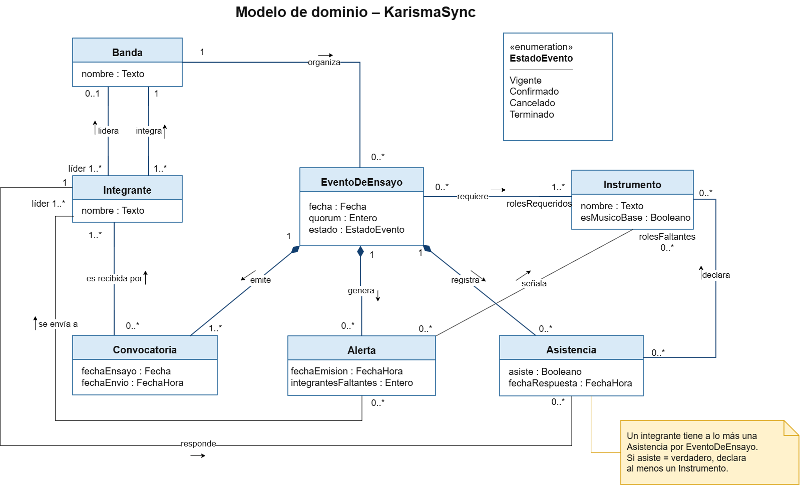

# Modelo de dominio

## Diagrama

Archivo fuente: [`./diagramas/modelo-dominio.drawio`](./diagramas/modelo-dominio.drawio)

## Descripción de las clases
| Clase | Qué representa en el negocio | Atributos |
|-------|------------------------------|-----------|
| Banda | Agrupación musical de la iglesia que organiza sus ensayos. | nombre |
| Integrante | Músico que forma parte de la banda; algunos cumplen además el rol de Líder de Alabanza. | nombre |
| EventoDeEnsayo | Ensayo propuesto para una fecha, con el quórum y los roles requeridos que lo hacen viable. | fecha, quorum, estado |
| Convocatoria | Aviso del evento de ensayo que reciben los integrantes al crearse o al reagendarse el ensayo. | fechaEnsayo, fechaEnvio |
| Asistencia | Respuesta de un integrante a un evento de ensayo, indicando si asistirá. | asiste, fechaRespuesta |
| Instrumento | Instrumento o rol musical (batería, bajo, guitarra, teclado, voz) que se requiere en un ensayo o que declara un integrante. | nombre, esMusicoBase |
| Alerta | Aviso al Líder de Alabanza de que el ensayo tiene condiciones pendientes: falta quórum o roles requeridos. | fechaEmision, integrantesFaltantes |

El atributo `estado` de EventoDeEnsayo toma los valores de la enumeración EstadoEvento: Vigente, Confirmado, Cancelado y Terminado (requisito derivado RD-01 y HU-04). El atributo `esMusicoBase` identifica los cuatro músicos base acordados en la [elicitación](./05-elicitacion.md): teclado, bajo, guitarra y batería.

## Asociaciones
| Asociación | Clases | Multiplicidades | Justificación |
|------------|--------|-----------------|----------------|
| integra | Integrante – Banda | 1..* a 1 | Cada integrante pertenece a la banda, y una banda tiene al menos un integrante (HU-01: la banda es convocada completa). |
| lidera | Integrante (líder) – Banda | 1..* a 0..1 | Solo el Líder de Alabanza puede crear y reagendar eventos (RNF-01). La banda tiene al menos un líder; la elicitación identificó dos responsables: el encargado y el director musical. Un integrante lidera a lo más una banda. |
| organiza | Banda – EventoDeEnsayo | 1 a 0..* | Cada evento de ensayo pertenece a una banda; una banda puede no tener ensayos o tener muchos (RF-01). |
| requiere | EventoDeEnsayo – Instrumento (rolesRequeridos) | 0..* a 1..* | Un evento exige indicar al menos un rol requerido (HU-01, escenario de error); un mismo instrumento puede requerirse en muchos eventos. |
| emite | EventoDeEnsayo – Convocatoria | 1 a 1..* | Al crear el evento se emite su convocatoria (RF-02), y al reagendarlo se emite una nueva con la fecha actualizada (HU-05). |
| es recibida por | Convocatoria – Integrante | 0..* a 1..* | Todos los integrantes de la banda reciben la convocatoria (HU-01); un integrante recibe convocatorias de distintos eventos. |
| registra | EventoDeEnsayo – Asistencia | 1 a 0..* | Las respuestas se registran dentro del evento (RF-06); un evento recién creado aún no tiene respuestas. |
| responde | Integrante – Asistencia | 1 a 0..* | Cada asistencia es la respuesta de un integrante; un integrante responde en distintos eventos, a lo más una vez por evento. |
| declara | Asistencia – Instrumento | 0..* a 0..* | Quien confirma que asistirá declara uno o más instrumentos (HU-03); quien no asistirá no declara ninguno. La regla «si asiste, al menos uno» se indica en una nota del diagrama. |
| genera | EventoDeEnsayo – Alerta | 1 a 0..* | La evaluación del quórum y los roles genera una alerta cuando quedan condiciones pendientes (RF-09); si el ensayo se confirma, no se genera ninguna. |
| se envía a | Alerta – Integrante (líder) | 0..* a 1..* | La alerta se dirige al Líder de Alabanza para que decida esperar o reagendar (HU-05). |
| señala | Alerta – Instrumento (rolesFaltantes) | 0..* a 0..* | La alerta indica qué rol falta (HU-04: «falta el rol batería»); si solo falta quórum, no señala ningún instrumento y usa `integrantesFaltantes`. |

## Decisiones de modelado
- **Líder de Alabanza se modeló como rol y no como clase.** Un líder es un integrante más de la banda que además coordina los ensayos; crear una clase aparte duplicaría a la persona. Se representa como el extremo «líder» de las asociaciones `lidera` y `se envía a`. El encargado y el director musical de la elicitación son dos integrantes con ese rol.
- **Instrumento cumple dos roles en el dominio:** `rolesRequeridos` en el evento y `rolesFaltantes` en la alerta. Se usa una sola clase porque el negocio habla del mismo catálogo («roles requeridos batería, bajo y voz», «con el instrumento voz»).
- **Se usó composición** entre EventoDeEnsayo y sus Convocatorias, Asistencias y Alertas, porque ninguna tiene sentido fuera del evento al que pertenece: si el evento no existiera, tampoco existirían su convocatoria, las respuestas a ella ni sus alertas.
- **No se usó agregación** entre Banda e Integrante: es una asociación simple (`integra`), porque el integrante es una persona que existe por sí misma y la relación no expresa una relación todo-parte relevante para el negocio.
- **No se usó herencia:** no hay subtipos del negocio con atributos propios; Líder de Alabanza es un rol, no un subtipo.
- **El servicio de notificaciones no es una clase del dominio:** es un sistema externo y aparece como actor en los [casos de uso](./09-casos-uso.md) y como participante en los [diagramas de secuencia](./10-diagramas-secuencia.md).
- **«En espera» no es un estado propio del evento:** según HU-05, cuando el líder decide esperar, el ensayo «sigue vigente y sin confirmar», por lo que se representa como EventoDeEnsayo en estado Vigente con una Alerta generada. El ciclo de vida detallado de EstadoEvento se describe en los [diagramas de estado](./11-diagramas-estado.md).
- **La agenda de la banda no se modeló como clase:** bloquear la agenda (RF-08) corresponde a que el EventoDeEnsayo pase al estado Confirmado. La regla exacta de qué agenda se bloquea sigue pendiente de validación, como se indica en los casos de uso.
