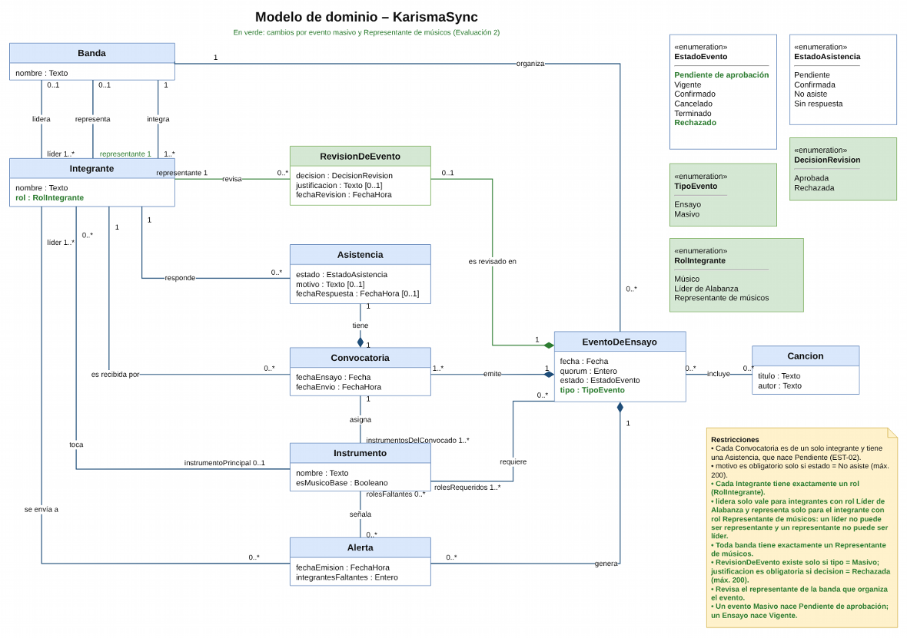

# Modelo de dominio

## Diagrama

Archivo fuente: [`./diagramas/modelo-dominio.drawio`](./diagramas/modelo-dominio.drawio)

## Descripción de las clases
| Clase | Qué representa en el negocio | Atributos |
|-------|------------------------------|-----------|
| Banda | Agrupación musical de la iglesia que organiza sus ensayos. | nombre |
| Integrante | Persona que forma parte de la banda. Según su rol es músico, Líder de Alabanza o Representante de músicos; los tres pueden ser convocados a un ensayo. | nombre, rol |
| EventoDeEnsayo | Evento propuesto para una fecha, con el quórum y los roles requeridos que lo hacen viable. Puede ser un ensayo o un evento masivo; el evento masivo debe aprobarlo el Representante de músicos antes de publicarse. | fecha, quorum, estado, tipo |
| Convocatoria | Aviso del evento de ensayo que reciben los integrantes al crearse o al reagendarse el ensayo. | fechaEnsayo, fechaEnvio |
| Asistencia | Respuesta de un músico convocado a su convocatoria: si asistirá o no y, si no asistirá, por qué. Nace Pendiente al emitirse la convocatoria. | estado, motivo, fechaRespuesta |
| Instrumento | Instrumento o rol musical (batería, bajo, guitarra eléctrica, guitarra acústica, teclado, voz) que se requiere en un ensayo, que un integrante registra como principal o que se asigna a un convocado. | nombre, esMusicoBase |
| Cancion | Canción del catálogo de la banda que puede formar parte del repertorio opcional de un evento. | titulo, autor |
| Alerta | Aviso al Líder de Alabanza de que el ensayo tiene condiciones pendientes: falta quórum o roles requeridos. | fechaEmision, integrantesFaltantes |
| RevisionDeEvento | Revisión que el Representante de músicos hace de un evento masivo antes de que se publique: si lo aprueba o lo rechaza, con qué justificación y cuándo. | decision, justificacion, fechaRevision |

El atributo `estado` de EventoDeEnsayo toma los valores de la enumeración EstadoEvento: Pendiente de aprobación, Vigente, Confirmado, Cancelado, Terminado y Rechazado (requisito derivado RD-01, HU-04 y HU-08). Un ensayo nace Vigente; un evento masivo nace Pendiente de aprobación y pasa a Vigente si el Representante de músicos lo aprueba o a Rechazado si lo rechaza. El atributo `tipo` toma los valores de la enumeración TipoEvento: Ensayo y Masivo. El atributo `decision` de RevisionDeEvento toma los valores de la enumeración DecisionRevision: Aprobada y Rechazada; `justificacion` es obligatoria solo cuando la decisión es Rechazada (máximo 200 caracteres). El atributo `rol` de Integrante toma los valores de la enumeración RolIntegrante: Músico, Líder de Alabanza y Representante de músicos; cada integrante tiene exactamente un rol.

## Asociaciones
| Asociación | Clases | Multiplicidades | Justificación |
|------------|--------|-----------------|----------------|
| integra | Integrante – Banda | 1..* a 1 | Cada integrante pertenece a la banda, y una banda tiene al menos un integrante (HU-01: el líder convoca a los integrantes de su banda que necesita). |
| lidera | Integrante (líder) – Banda | 1..* a 0..1 | Solo el Líder de Alabanza puede crear y reagendar eventos (RNF-01). La banda tiene al menos un líder; la elicitación identificó dos responsables: el encargado y el director musical. Un integrante lidera a lo más una banda. Solo la tiene un integrante con rol Líder de Alabanza. |
| representa | Integrante (representante) – Banda | 1 a 0..1 | Toda banda tiene exactamente un Representante de músicos, que está entre el líder y los músicos y aprueba o rechaza los eventos masivos (HU-08). Solo la tiene un integrante con rol Representante de músicos; un integrante representa a lo más una banda. |
| toca | Integrante – Instrumento (instrumentoPrincipal) | 1 a 0..1 | Cada integrante registra como máximo un instrumento principal (HU-06); un instrumento puede ser principal de muchos integrantes. Un integrante sin perfil registrado aún no tiene principal. |
| organiza | Banda – EventoDeEnsayo | 1 a 0..* | Cada evento de ensayo pertenece a una banda; una banda puede no tener ensayos o tener muchos (RF-01). |
| revisa | Integrante (representante) – RevisionDeEvento | 1 a 0..* | Cada revisión la hace el Representante de músicos de la banda que organiza el evento; un representante hace muchas revisiones (HU-08). |
| es revisado en | RevisionDeEvento – EventoDeEnsayo | 0..1 a 1 | Un evento masivo tiene a lo más una revisión, y cada revisión pertenece a un solo evento. Un ensayo no tiene revisión. Es composición: si el evento no existe, su revisión tampoco. |
| requiere | EventoDeEnsayo – Instrumento (rolesRequeridos) | 0..* a 1..* | Un evento tiene al menos un rol requerido porque exige al menos un músico convocado con al menos un instrumento (HU-01, CA8); un mismo instrumento puede requerirse en muchos eventos. Se deriva de la unión de los instrumentos asignados en las convocatorias. |
| incluye | EventoDeEnsayo – Cancion (repertorio) | 0..* a 0..* | Un evento puede incluir cero o más canciones del catálogo y una canción puede estar en muchos eventos. La ausencia de canciones representa un evento sin repertorio, como una reunión de coordinación (HU-07). |
| emite | EventoDeEnsayo – Convocatoria | 1 a 1..* | Al crear el evento se emite su convocatoria (RF-02), y al reagendarlo se emite una nueva con la fecha actualizada (HU-05). |
| es recibida por | Convocatoria – Integrante | 0..* a 1..* | Solo los integrantes convocados reciben la convocatoria (HU-01); un integrante recibe convocatorias de distintos eventos. |
| asigna | Convocatoria – Instrumento (instrumentosDelConvocado) | 1 a 1..* | El líder convoca a cada músico con uno o más instrumentos, que pueden o no incluir su principal (HU-01); un instrumento puede asignarse en muchas convocatorias. |
| tiene | Convocatoria – Asistencia | 1 a 1 | Cada convocatoria tiene exactamente una asistencia, que nace Pendiente al emitirse (EST-02) y guarda la respuesta del convocado y su motivo (HU-03, RF-06). Reemplaza a la asociación `registra` (EventoDeEnsayo – Asistencia): las asistencias de un evento son las de sus convocatorias. |
| responde | Integrante – Asistencia | 1 a 0..* | Cada asistencia es la respuesta de un integrante; un integrante responde en distintos eventos, a lo más una vez por evento. |
| genera | EventoDeEnsayo – Alerta | 1 a 0..* | La evaluación del quórum y los roles genera una alerta cuando quedan condiciones pendientes (RF-09); si el ensayo se confirma, no se genera ninguna. |
| se envía a | Alerta – Integrante (líder) | 0..* a 1..* | La alerta se dirige al Líder de Alabanza para que decida esperar o reagendar (HU-05). |
| señala | Alerta – Instrumento (rolesFaltantes) | 0..* a 0..* | La alerta indica qué rol falta (HU-04: «falta el rol batería»); si solo falta quórum, no señala ningún instrumento y usa `integrantesFaltantes`. |

## Decisiones de modelado
- **Líder de Alabanza y Representante de músicos se modelaron como roles y no como clases.** Ambos son integrantes de la banda (se les puede convocar a ensayos) que además tienen permisos distintos; crear clases aparte duplicaría a la persona. El rol se registra en el atributo `rol` (enumeración RolIntegrante) y se usa en los extremos «líder» de `lidera` y `se envía a`, y «representante» de `representa` y `revisa`. El encargado y el director musical de la elicitación son dos integrantes con rol Líder de Alabanza.
- **Un solo atributo `rol` en vez de booleanos.** El booleano anterior (¿es líder?) no distingue tres roles. Con dos booleanos (¿es líder?, ¿es representante?) una persona podría tener ambos, lo que el negocio prohíbe. Con un único `rol` la exclusión se cumple en ambos sentidos: un líder no puede ser representante y un representante no puede ser líder. `lidera` solo vale para integrantes con rol Líder de Alabanza y `representa` solo para el integrante con rol Representante de músicos.
- **El tipo de evento es una enumeración y no un booleano.** `tipo : TipoEvento` (Ensayo, Masivo) permite agregar otros tipos sin cambiar el modelo, por la misma razón por la que `rol` reemplaza al booleano de líder.
- **La aprobación del evento masivo se modela con una clase `RevisionDeEvento`.** La revisión tiene datos propios (decisión, justificación y fecha) y un responsable (el representante, por `revisa`), así que no basta con un atributo del evento. Además, Pendiente de aprobación y Rechazado son valores de EstadoEvento, porque un evento masivo no aprobado no puede convocarse ni recibir respuestas; el detalle de las transiciones está en los [diagramas de estado](./11-diagramas-estado.md).
- **«Rechazado» aparece en el estado del evento y en la decisión de la revisión, con propósitos distintos.** `EstadoEvento` describe el ciclo de vida del evento (qué se puede hacer con él ahora); `DecisionRevision` es el registro de lo que decidió el representante, junto con su justificación y su fecha. La regla que las une: cuando la revisión se registra, el evento pasa a Vigente si la decisión es Aprobada y a Rechazado si es Rechazada.
- **Instrumento cumple dos roles en el dominio:** `rolesRequeridos` en el evento y `rolesFaltantes` en la alerta. Se usa una sola clase porque el negocio habla del mismo catálogo («roles requeridos batería, bajo y voz», «con el instrumento voz»).
- **El instrumento principal es una asociación, no un atributo duplicado.** Se modela con `toca` (Integrante – Instrumento) para reutilizar el catálogo y evitar guardar el nombre del instrumento dos veces (HU-06). La multiplicidad 1–0..1 expresa que solo se registra el principal y que un perfil puede estar aún incompleto.
- **El repertorio se modela como asociación y no como un booleano en el evento.** `incluye` (EventoDeEnsayo – Cancion) con 0..* en ambos extremos expresa que las canciones son opcionales. No se agrega un atributo «incluyeRepertorio» porque el evento sin canciones ya representa el caso de una reunión; el bloque activado por defecto es una decisión de interfaz (HU-07) y no un estado del dominio.
- **`rolesRequeridos` se deriva de las convocatorias.** El líder asigna instrumentos a cada músico convocado en `asigna`; el conjunto de roles requeridos del evento es la unión de esos instrumentos. Así HU-04 sigue comparando la cobertura sin un catálogo paralelo en el evento.
- **Se usó composición** entre EventoDeEnsayo y sus Convocatorias, Alertas y su RevisionDeEvento, y entre cada Convocatoria y su Asistencia, porque ninguna tiene sentido fuera del todo al que pertenece: si el evento no existiera, tampoco existirían su convocatoria, la respuesta a ella, sus alertas ni su revisión.
- **La respuesta se modela con un estado y no con un booleano.** `asiste` no distinguía entre «todavía no responde» y «no asistirá»; EstadoAsistencia sí, y permite que la respuesta cambie mientras el evento esté vigente (HU-03, CA7). Los instrumentos de la asistencia son los asignados en la convocatoria (`asigna`): el integrante no los declara.
- **No se usó agregación** entre Banda e Integrante: es una asociación simple (`integra`), porque el integrante es una persona que existe por sí misma y la relación no expresa una relación todo-parte relevante para el negocio.
- **No se usó herencia:** no hay subtipos del negocio con atributos propios; Líder de Alabanza y Representante de músicos son roles, no subtipos. Un atributo permite además cambiar el rol de una persona sin cambiarla de clase.
- **El servicio de notificaciones no es una clase del dominio:** es un sistema externo y aparece como actor en los [casos de uso](./09-casos-uso.md) y como participante en los [diagramas de secuencia](./10-diagramas-secuencia.md).
- **«En espera» no es un estado propio del evento:** según HU-05, cuando el líder decide esperar, el ensayo «sigue vigente y sin confirmar», por lo que se representa como EventoDeEnsayo en estado Vigente con una Alerta generada. El ciclo de vida detallado de EstadoEvento se describe en los [diagramas de estado](./11-diagramas-estado.md).
- **La agenda de la banda no se modeló como clase:** bloquear la agenda (RF-08) corresponde a que el EventoDeEnsayo pase al estado Confirmado. La regla exacta de qué agenda se bloquea sigue pendiente de validación, como se indica en los casos de uso.

## Cambio de la Evaluación 2: evento masivo y Representante de músicos

**Cambio solicitado:** se agrega un nuevo tipo de evento, el **evento masivo**, que antes de publicarse debe ser **aprobado o rechazado (con justificación)** por un nuevo rol, el **Representante de músicos**, que está entre el Líder de Alabanza y los músicos (HU-08).

**Por qué el modelo de dominio tuvo que cambiar:**
- **Un nuevo rol.** Antes, ser o no ser Líder de Alabanza era un sí/no (en la base de datos, `es_lider` 0/1). Con un tercer rol ese sí/no ya no alcanza, y el negocio exige que un líder no pueda ser representante ni un representante líder. Por eso `Integrante` ganó `rol : RolIntegrante`: con un solo valor por persona, la regla se cumple en ambos sentidos.
- **Toda banda tiene representante.** Sin representante, un evento masivo quedaría Pendiente de aprobación para siempre. Por eso `representa` tiene multiplicidad 1 en el extremo del representante.
- **Un nuevo tipo de evento.** El modelo no distinguía un ensayo de un evento masivo. Se agregó `tipo : TipoEvento` (Ensayo, Masivo), como enumeración y no como booleano para poder sumar otros tipos sin rehacer el modelo.
- **La revisión antes de publicar.** Un evento masivo no puede convocarse hasta que el representante lo revise. La revisión tiene datos propios (decisión, justificación obligatoria si rechaza, fecha), por eso es la clase `RevisionDeEvento`, unida al representante (`revisa`) y al evento (`es revisado en`). `EstadoEvento` suma Pendiente de aprobación y Rechazado.

**Antes → después:**

| Elemento | Antes (`cambio-validado`) | Después |
|----------|---------------------------|---------|
| `Integrante` | nombre | nombre, `rol : RolIntegrante` |
| `EventoDeEnsayo` | fecha, quorum, estado | + `tipo : TipoEvento` |
| `EstadoEvento` | Vigente, Confirmado, Cancelado, Terminado | + Pendiente de aprobación, + Rechazado |
| Clase nueva | — | `RevisionDeEvento` (decision, justificacion, fechaRevision) |
| Enumeraciones nuevas | — | `RolIntegrante`, `TipoEvento`, `DecisionRevision` |
| Asociaciones nuevas | — | `representa` (Integrante – Banda, 1 a 0..1), `revisa` (Integrante – RevisionDeEvento, 1 a 0..*), `es revisado en` (RevisionDeEvento – EventoDeEnsayo, 0..1 a 1, composición) |

**Qué se corrigió respecto del borrador del martes:** el borrador usaba `id_integrante` (los identificadores no van en un modelo de dominio), `tipo_integrante : String` y `tipo_ensayo` sin tipo definido. Se reemplazaron por enumeraciones. Además se agregaron la clase `RevisionDeEvento` (el borrador no registraba la decisión ni su justificación), la multiplicidad 1 del representante y la regla de que un líder no puede ser representante ni viceversa.

## Borrador hecho en clase (24/11)

Versión dibujada a mano en la sesión del martes (`cambio-validado`), conservada como evidencia del cambio.

