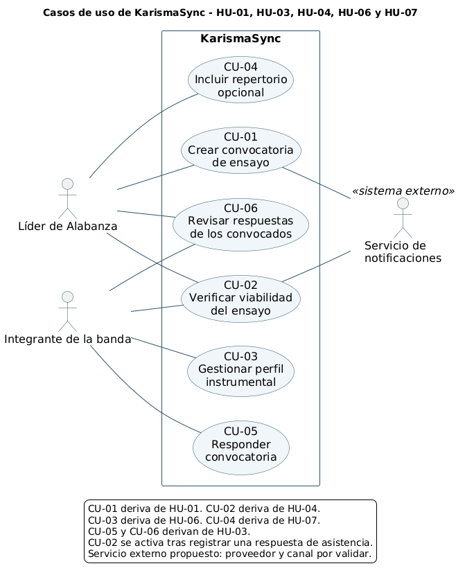
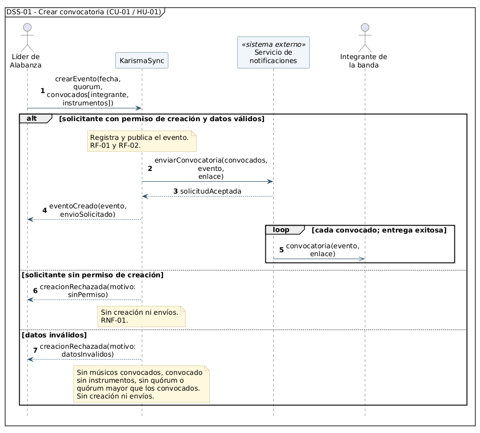
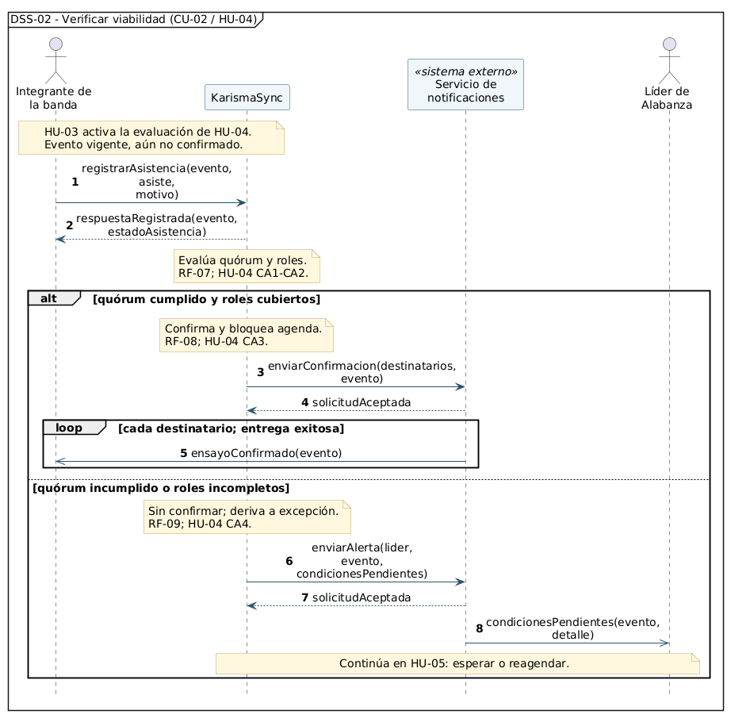
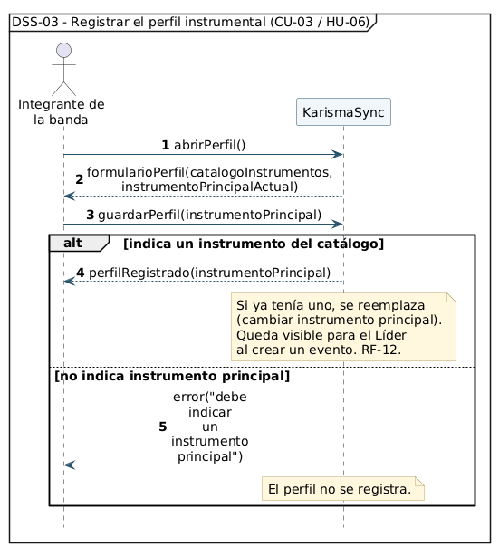
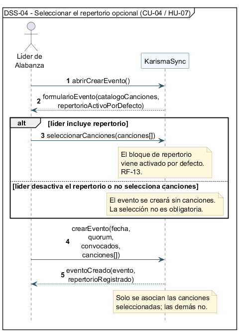
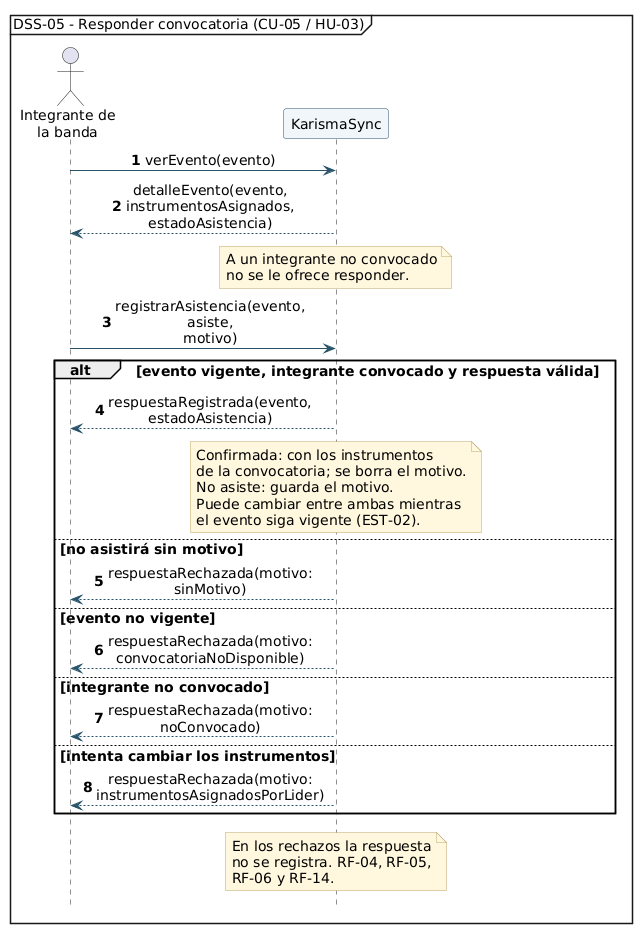
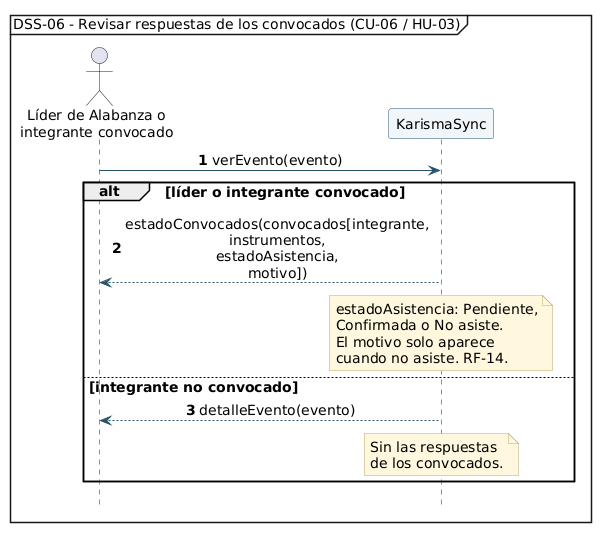

# Casos de uso y secuencias de sistema — KarismaSync

Se representan cinco historias del proyecto mediante un diagrama de casos de uso y seis secuencias de sistema con alternativas.

## 1. Historias y trazabilidad

| Historia de origen | Caso de uso | Secuencia | Requisitos |
|---|---|---|---|
| [HU-01: Crear evento de ensayo con roles requeridos](./04-historias-usuario.md#hu-01-crear-evento-de-ensayo-con-roles-requeridos) | [CU-01: Crear convocatoria de ensayo](#cu-01-crear-convocatoria-de-ensayo) | [DSS-01](#dss-01-crear-convocatoria) | RF-01, RF-02, RNF-01, RNF-04 |
| [HU-04: Evaluar automáticamente el quórum y los roles requeridos](./04-historias-usuario.md#hu-04-evaluar-automáticamente-el-quórum-y-los-roles-requeridos) | [CU-02: Verificar viabilidad del ensayo](#cu-02-verificar-viabilidad-del-ensayo) | [DSS-02](#dss-02-verificar-viabilidad) | RF-07, RF-08, RF-09, RNF-04 |
| [HU-06: Registrar el perfil instrumental del integrante](./04-historias-usuario.md#hu-06-registrar-el-perfil-instrumental-del-integrante) | [CU-03: Gestionar perfil instrumental del integrante](#cu-03-gestionar-perfil-instrumental-del-integrante) | [DSS-03](#dss-03-registrar-el-perfil-instrumental) | RF-12 |
| [HU-07: Incluir un repertorio opcional de canciones en el evento](./04-historias-usuario.md#hu-07-incluir-un-repertorio-opcional-de-canciones-en-el-evento) | [CU-04: Incluir repertorio opcional al crear un evento](#cu-04-incluir-repertorio-opcional-al-crear-un-evento) | [DSS-04](#dss-04-seleccionar-el-repertorio-opcional) | RF-13 |
| [HU-03: Confirmar asistencia al ensayo](./04-historias-usuario.md#hu-03-confirmar-asistencia-al-ensayo) | [CU-05: Responder convocatoria](#cu-05-responder-convocatoria) | [DSS-05](#dss-05-responder-convocatoria) | RF-04, RF-05, RF-06, RF-14 |
| [HU-03: Confirmar asistencia al ensayo](./04-historias-usuario.md#hu-03-confirmar-asistencia-al-ensayo) | [CU-06: Revisar respuestas de los convocados](#cu-06-revisar-respuestas-de-los-convocados) | [DSS-06](#dss-06-revisar-respuestas-de-los-convocados) | RF-14 |

Las historias HU-01 y HU-04 requieren notificaciones (convocar a la banda y comunicar la confirmación o las condiciones pendientes); HU-06 y HU-07 no las requieren. CU-04 describe la selección opcional del repertorio dentro de la creación del evento.

## 2. Diagrama de casos de uso

Fuente editable: [casos-de-uso.puml](./diagramas/casos-de-uso.puml).

- **Líder de Alabanza:** crea la convocatoria, selecciona opcionalmente el repertorio de canciones y recibe alertas.
- **Líder de Alabanza e integrantes convocados:** revisan las respuestas de los convocados (estado y motivo).
- **Integrante de la banda:** responde la convocatoria (confirma o indica que no asistirá, con motivo), registra su perfil instrumental y recibe notificaciones; no crea convocatorias.
- **Servicio de notificaciones:** sistema externo que distribuye los mensajes.

Los casos están dentro de KarismaSync y los actores fuera. No se requiere `include` ni `extend`: son objetivos que ocurren en momentos distintos.

## CU-01: Crear convocatoria de ensayo

**Origen:** HU-01, CA1–CA8. **Actor principal:** Líder de Alabanza.

**Condición inicial:** solicitante identificado, banda conocida, músicos con su instrumento principal registrado y datos válidos para el escenario.

**Flujo principal:** el líder envía la fecha, el quórum, los músicos convocados y el o los instrumentos asignados a cada uno. KarismaSync comprueba sus permisos, registra el evento con los roles que resultan de esos instrumentos y lo deja disponible. Solicita al servicio externo enviar la convocatoria con su enlace solo a los músicos convocados, recibe la aceptación del envío e informa al líder. El servicio entrega las notificaciones a los convocados.

**Alternativas:** si el solicitante carece del permiso de creación, KarismaSync rechaza la solicitud sin crear el evento ni enviar notificaciones (RNF-01). Si no hay ningún músico convocado, algún convocado queda sin instrumentos, no se indica el quórum o el quórum supera la cantidad de músicos convocados, rechaza la solicitud e informa al líder.

### DSS-01: Crear convocatoria

Fuente editable: [dss-01-crear-convocatoria.puml](./diagramas/dss-01-crear-convocatoria.puml).

## CU-02: Verificar viabilidad del ensayo

**Origen:** HU-04, CA1–CA4. **Beneficiario principal:** Líder de Alabanza.

**Condición inicial:** evento vigente, aún no confirmado, con roles requeridos y una regla de evaluación disponible. El integrante registra una respuesta válida.

**Flujo principal:** el registro de asistencia e instrumentos de HU-03 activa la evaluación, siguiendo el [TO-BE](./02-rediseno-to-be.md#actividades-que-cambian-del-as-is-al-to-be). KarismaSync evalúa quórum y roles. Si ambos se cumplen, confirma el ensayo, bloquea la agenda y solicita notificar a la banda mediante el servicio externo.

**Alternativa:** si falta quórum o cobertura de roles, mantiene el ensayo sin confirmar y solicita alertar al líder con las condiciones pendientes. La decisión posterior de esperar o reagendar pertenece a HU-05.

### DSS-02: Verificar viabilidad

Fuente editable: [dss-02-verificar-viabilidad.puml](./diagramas/dss-02-verificar-viabilidad.puml).

## CU-03: Gestionar perfil instrumental del integrante

**Origen:** HU-06, CA1–CA4. **Actor principal:** Integrante de la banda.

**Condición inicial:** integrante identificado y catálogo de instrumentos disponible.

**Flujo principal:** el integrante abre su perfil, selecciona su instrumento principal y KarismaSync lo registra. El instrumento queda disponible para que el Líder de Alabanza lo vea al crear un evento. El integrante puede cambiar su instrumento principal más adelante.

**Alternativa:** si el integrante no indica un instrumento principal, KarismaSync no registra el perfil y le informa que debe indicar uno.

### DSS-03: Registrar el perfil instrumental

Fuente editable: [dss-03-registrar-perfil-instrumental.puml](./diagramas/dss-03-registrar-perfil-instrumental.puml).

## CU-04: Incluir repertorio opcional al crear un evento

**Origen:** HU-07, CA1–CA7. **Actor principal:** Líder de Alabanza.

**Condición inicial:** el líder está creando un evento y el catálogo de canciones de la banda está disponible.

**Flujo principal:** al abrir el formulario de creación, KarismaSync muestra el bloque de repertorio activado por defecto con las canciones del catálogo. El líder puede seleccionar una o varias canciones y luego crear el evento. KarismaSync registra únicamente las canciones seleccionadas y las asocia al evento; el detalle muestra el repertorio registrado.

**Alternativas:** el líder puede desactivar el bloque de repertorio o dejar la selección vacía. En ambos casos el evento se crea sin canciones y el detalle indica que no incluye repertorio. Las canciones no seleccionadas no se asocian.

### DSS-04: Seleccionar el repertorio opcional

Fuente editable: [dss-04-seleccionar-repertorio.puml](./diagramas/dss-04-seleccionar-repertorio.puml).

## CU-05: Responder convocatoria

**Origen:** HU-03, CA1–CA8. **Actor principal:** Integrante de la banda (músico convocado).

**Condición inicial:** el integrante está identificado y el evento existe.

**Flujo principal:** el integrante abre el evento. KarismaSync le muestra la fecha, los instrumentos que el Líder de Alabanza le asignó y el estado de su respuesta. El integrante confirma que asistirá. KarismaSync verifica que el evento esté vigente y que el integrante haya sido convocado, y registra la asistencia como Confirmada con los instrumentos asignados en la convocatoria.

**Alternativas:**
- **No asiste:** el integrante indica que no asistirá y escribe el motivo; KarismaSync registra la asistencia como No asiste con ese motivo.
- **Sin motivo:** si indica que no asistirá sin escribir un motivo, KarismaSync no registra la respuesta (sigue Pendiente) e informa que debe indicar el motivo.
- **Cambiar respuesta:** mientras el evento esté vigente, el integrante puede pasar de Confirmada a No asiste (con motivo) o de No asiste a Confirmada; en este último caso se borra el motivo anterior.
- **Evento no vigente:** si el evento fue cancelado o terminó, KarismaSync no registra la respuesta e informa que la convocatoria ya no está disponible.
- **No convocado:** un integrante no convocado puede ver el evento, pero no la opción de responder ni las respuestas; si intenta responder, KarismaSync lo rechaza e informa que no fue convocado.
- **Cambiar instrumentos:** si el integrante intenta cambiar los instrumentos de su convocatoria, KarismaSync no los modifica e informa que solo el Líder de Alabanza puede asignarlos.

### DSS-05: Responder convocatoria

Fuente editable: [dss-05-responder-convocatoria.puml](./diagramas/dss-05-responder-convocatoria.puml).

## CU-06: Revisar respuestas de los convocados

**Origen:** HU-03, CA9. **Actores:** Líder de Alabanza e integrante convocado.

**Condición inicial:** el evento existe y tiene músicos convocados.

**Flujo principal:** el actor abre el detalle del evento. KarismaSync muestra a cada convocado con sus instrumentos, el estado de su respuesta (Pendiente, Confirmada o No asiste) y el motivo cuando no asiste.

**Alternativa:** si quien abre el evento no es el Líder de Alabanza ni un músico convocado, KarismaSync muestra los datos del evento sin las respuestas de los convocados.

### DSS-06: Revisar respuestas de los convocados

Fuente editable: [dss-06-revisar-respuestas.puml](./diagramas/dss-06-revisar-respuestas.puml).

## 3. Lectura de las secuencias y supuestos

KarismaSync aparece como una única caja negra. El marco exterior contiene el escenario completo; `alt` contiene solamente los pasos que cambian según la condición. Por eso la solicitud inicial y la evaluación previa quedan fuera del `alt`. El `loop` repite la entrega para cada destinatario.

- **Integración propuesta:** proveedor externo de notificaciones, aún sin canal ni marca definidos. Las secuencias muestran envíos exitosos; aceptar una solicitud no acredita su entrega.
- **DSS-03 sin sistema externo:** el registro del perfil instrumental solo involucra al integrante y a KarismaSync; no genera notificaciones.
- **DSS-05 y DSS-06 sin sistema externo:** responder la convocatoria y revisar las respuestas no generan notificaciones. La evaluación del quórum que se activa tras registrar una respuesta pertenece a HU-04 (DSS-02).
- **Reglas pendientes:** validar la fórmula exacta de quórum y qué agenda se bloquea. No se inventa un porcentaje ni una integración de calendario.
- **Coherencia:** nombres y condiciones provienen de las [historias](./04-historias-usuario.md) y los [requisitos](./03-requisitos.md). El vocabulario deberá contrastarse con el modelo de dominio cuando esté disponible.

Las fuentes PlantUML y los PNG están en `diagramas/`. Se verificó su sintaxis y se revisó su legibilidad. La integración propuesta y las reglas pendientes requieren validación del equipo.
