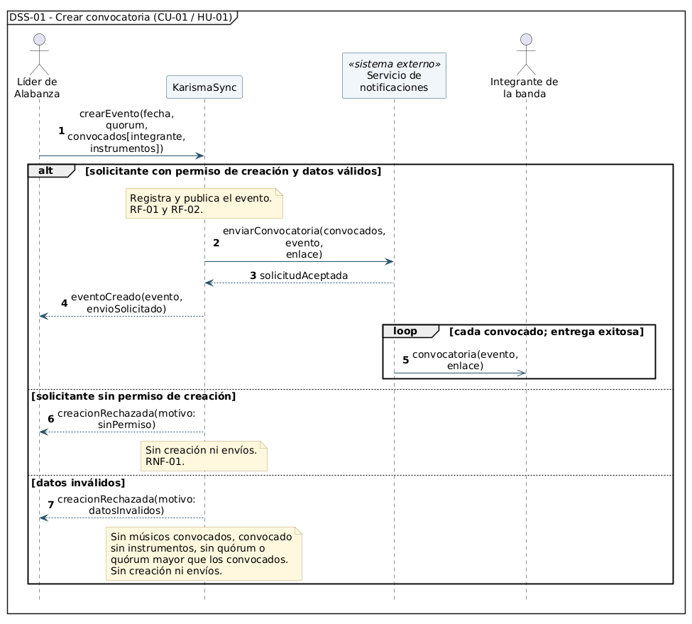
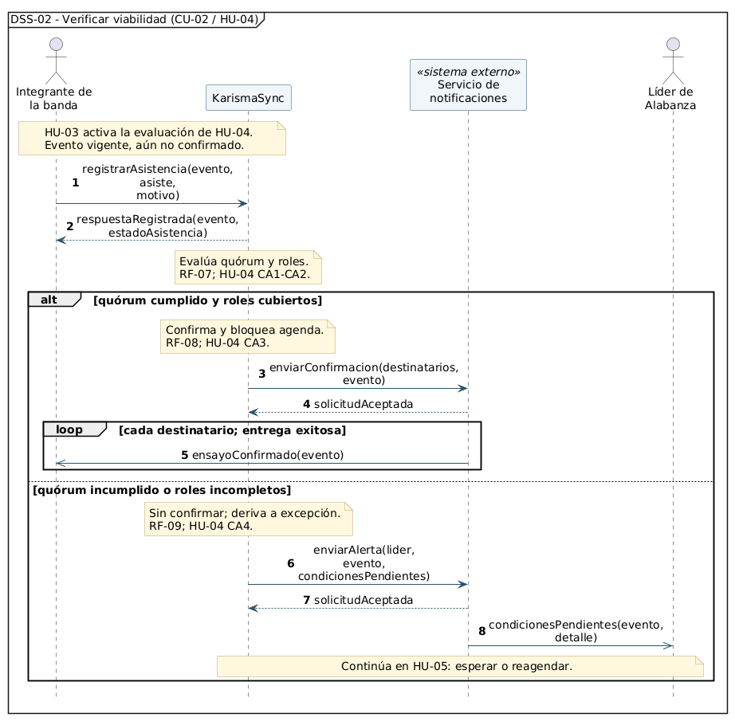
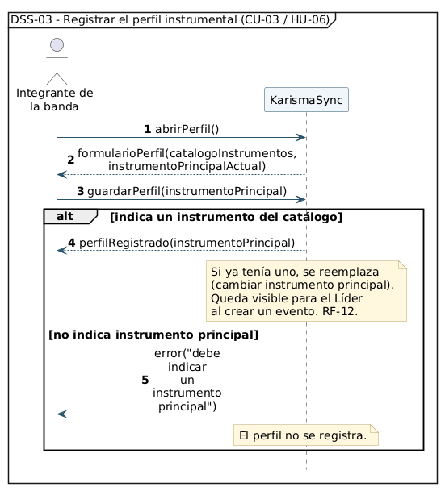
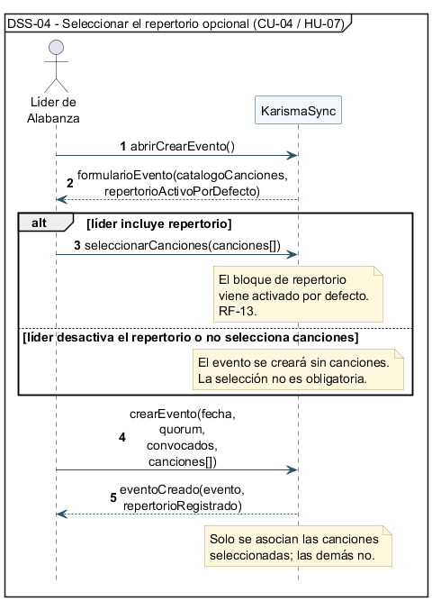
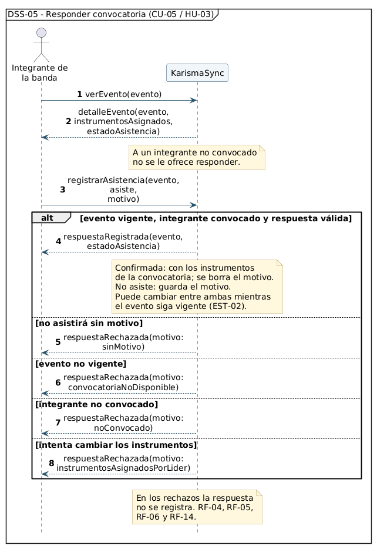
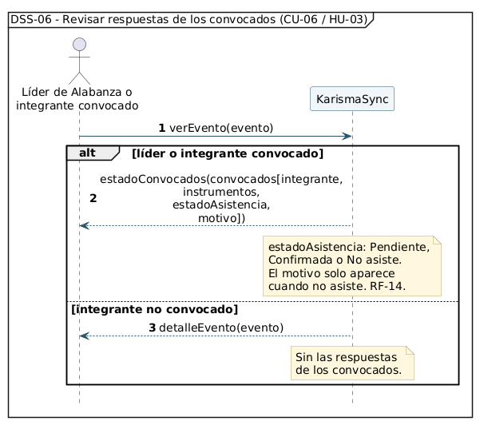

# Diagramas de secuencia de sistema
 
## DSS-01 — [Crear convocatoria]
- Caso de uso: [CU-01](./09-casos-uso.md)
- Historia: [HU-01](./04-historias-usuario.md#hu-01)
- Sistemas externos que participan: [Sistema de notificaciones]
 

Archivo fuente: [`./diagramas/dss-01-crear-convocatoria.puml`](./diagramas/dss-01-crear-convocatoria.puml)
 
Mensajes representados: `crearEvento(fecha, quorum, convocados[integrante, instrumentos])`; `enviarConvocatoria(convocados, evento, enlace)`; `creacionRechazada(motivo)`.

Variantes representadas: creación autorizada con datos válidos; rechazo por falta de permiso (`sinPermiso`); rechazo por datos inválidos (`datosInvalidos`: sin convocados, convocado sin instrumentos, sin quórum o quórum mayor que los convocados).
 
## DSS-02 — [Verificar viabilidad]
- Caso de uso: [CU-02](./09-casos-uso.md#cu-02-verificar-viabilidad-del-ensayo)
- Historia: [HU-04](./04-historias-usuario.md#hu-04)
- Sistemas externos que participan: [Sistema de notificaciones]
 

 
Archivo fuente: [`./diagramas/dss-02-verificar-viabilidad.puml`](./diagramas/dss-02-verificar-viabilidad.puml)
 
Mensajes representados: `registrarAsistencia(evento, asiste, motivo)` (el mismo mensaje de DSS-05) y `respuestaRegistrada(evento, estadoAsistencia)`; la evaluación usa los instrumentos asignados en la convocatoria.
 
Variantes representadas: confirmación del ensayo o alerta por quórum o roles pendientes.

## DSS-03 — Registrar el perfil instrumental
- Caso de uso: [CU-03](./09-casos-uso.md#cu-03-gestionar-perfil-instrumental-del-integrante)
- Historia: [HU-06](./04-historias-usuario.md#hu-06-registrar-el-perfil-instrumental-del-integrante)
- Sistemas externos que participan: Ninguno

Archivo fuente: [`./diagramas/dss-03-registrar-perfil-instrumental.puml`](./diagramas/dss-03-registrar-perfil-instrumental.puml)

Variantes representadas: el integrante registra o cambia su instrumento principal; si no indica ninguno, el sistema no guarda y responde con error.

## DSS-04 — Seleccionar el repertorio opcional
- Caso de uso: [CU-04](./09-casos-uso.md#cu-04-incluir-repertorio-opcional-al-crear-un-evento)
- Historia: [HU-07](./04-historias-usuario.md#hu-07-incluir-un-repertorio-opcional-de-canciones-en-el-evento)
- Sistemas externos que participan: Ninguno

Archivo fuente: [`./diagramas/dss-04-seleccionar-repertorio.puml`](./diagramas/dss-04-seleccionar-repertorio.puml)

Mensajes representados: `abrirCrearEvento()`, `formularioEvento(catalogoCanciones, repertorioActivoPorDefecto)` y `crearEvento(fecha, quorum, convocados, canciones[])`.

Variantes representadas: el líder incluye repertorio y selecciona canciones, o desactiva el bloque o deja la selección vacía; en ambos casos el evento se crea y solo se asocian las canciones seleccionadas.

## DSS-05 — Responder convocatoria
- Caso de uso: [CU-05](./09-casos-uso.md#cu-05-responder-convocatoria)
- Historia: [HU-03](./04-historias-usuario.md#hu-03-confirmar-asistencia-al-ensayo)
- Sistemas externos que participan: Ninguno

Archivo fuente: [`./diagramas/dss-05-responder-convocatoria.puml`](./diagramas/dss-05-responder-convocatoria.puml)

Mensajes representados: `verEvento(evento)`, `detalleEvento(evento, instrumentosAsignados, estadoAsistencia)`, `registrarAsistencia(evento, asiste, motivo)`, `respuestaRegistrada(evento, estadoAsistencia)` y `respuestaRechazada(motivo)`.

Variantes representadas: respuesta válida (confirmar, no asistir con motivo o cambiar la respuesta); rechazo por falta de motivo (`sinMotivo`), evento no vigente (`convocatoriaNoDisponible`), integrante no convocado (`noConvocado`) o intento de cambiar los instrumentos (`instrumentosAsignadosPorLider`).

## DSS-06 — Revisar respuestas de los convocados
- Caso de uso: [CU-06](./09-casos-uso.md#cu-06-revisar-respuestas-de-los-convocados)
- Historia: [HU-03](./04-historias-usuario.md#hu-03-confirmar-asistencia-al-ensayo)
- Sistemas externos que participan: Ninguno

Archivo fuente: [`./diagramas/dss-06-revisar-respuestas.puml`](./diagramas/dss-06-revisar-respuestas.puml)

Mensajes representados: `verEvento(evento)` y `estadoConvocados(convocados[integrante, instrumentos, estadoAsistencia, motivo])`.

Variantes representadas: el Líder de Alabanza ve las respuestas con el motivo de cada inasistencia; un músico convocado ve las respuestas sin los motivos de los demás (`estadoConvocados(convocados[integrante, instrumentos, estadoAsistencia])`); un integrante no convocado ve el evento sin las respuestas (`detalleEvento(evento)`).
