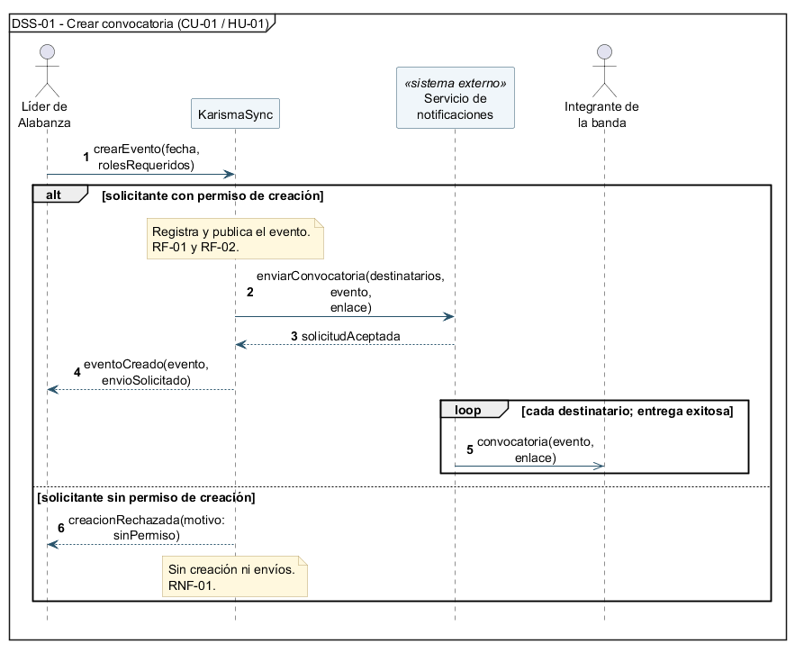

# Diagramas de secuencia de sistema
 
## DSS-01 — [Crear convocatoria]
- Caso de uso: [CU-01](./09-casos-de-uso.md)
- Historia: [HU-01](./04-historias-usuario.md#hu-01)
- Sistemas externos que participan: [Sistema de notificaciones]
 

## DSS-02 — [Verificar viabilidad]
- Caso de uso: [CU-04](./09-casos-de-uso.md)
- Historia: [HU-04](./04-historias-usuario.md#hu-04)
- Sistemas externos que participan: [Sistema de notificaciones]
 

 
Archivo fuente: [`./diagramas/dss-02.puml`](./diagramas/dss-02.puml)
 
Variantes representadas: [descripción de cada alt/opt/loop]
