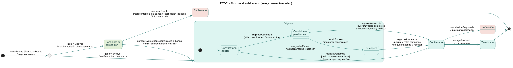
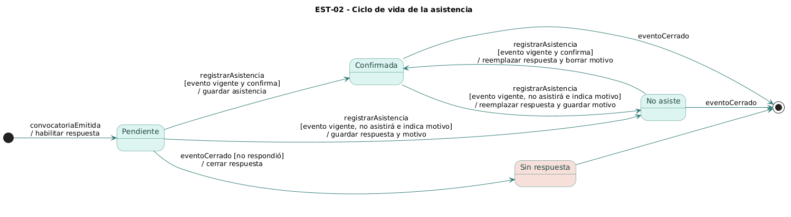

# Diagramas de estado

En esta parte se muestran los cambios de estado de dos elementos de KarismaSync: el evento de ensayo y la asistencia de cada integrante. Los diagramas permiten entender qué pasa con una convocatoria y con las respuestas que recibe.

## EST-01 — Ciclo de vida del evento de ensayo

- **Clase del dominio:** `EventoDeEnsayo` ([modelo de dominio](./08-modelo-dominio.md)).
- **Historias relacionadas:** [HU-01, HU-02, HU-04 y HU-05](./04-historias-usuario.md).
- **Diagramas de secuencia relacionados:** [DSS-01 y DSS-02](./10-diagramas-secuencia.md).

**Archivo fuente (PlantUML):** [est-01.puml](./diagramas/est-01.puml).

El evento comienza cuando el líder crea la convocatoria. Mientras está **Vigente**, puede encontrarse en tres situaciones: **Convocatoria abierta**, **Condiciones pendientes** o **En espera**. Estas situaciones se muestran dentro de Vigente para mantener la relación con el modelo de dominio.

Si se completa el quórum y están cubiertos los roles necesarios, el evento pasa a **Confirmado**. Si todavía falta algo, se avisa al líder para que decida si espera nuevas respuestas o reagenda el ensayo. Una vez confirmado, el evento puede terminar o quedar cancelado.

### Tabla de transiciones — EST-01

| Estado origen | Evento | Guarda | Acción | Estado destino |
|---|---|---|---|---|
| Inicial | `crearEvento` | Líder autorizado | Registrar el ensayo y notificar | Vigente / Convocatoria abierta |
| Convocatoria abierta | `registrarAsistencia` | Falta quórum o algún rol | Avisar al líder | Condiciones pendientes |
| Convocatoria abierta | `registrarAsistencia` | Quórum y roles completos | Bloquear agenda y notificar | Confirmado |
| Condiciones pendientes | `registrarAsistencia` | Quórum y roles completos | Bloquear agenda y notificar | Confirmado |
| Condiciones pendientes | `decidirEsperar` | Decisión del líder | Mantener la convocatoria | En espera |
| En espera | `reagendarEvento` | Decisión del líder | Actualizar fecha y notificar | Convocatoria abierta |
| En espera | `registrarAsistencia` | Quórum y roles completos | Bloquear agenda y notificar | Confirmado |
| Confirmado | `ensayoFinalizado` | — | Cerrar el evento | Terminado |
| Confirmado | `cancelacionRegistrada` | — | Informar cancelación | Cancelado |
| Terminado | Fin del ciclo | — | — | Final |
| Cancelado | Fin del ciclo | — | — | Final |

**Aclaración:** el modelo de dominio define **Vigente** como estado del evento. En este diagrama, *Convocatoria abierta*, *Condiciones pendientes* y *En espera* se usan como subestados para explicar con más detalle lo que ocurre antes de confirmar el ensayo. La Entrega 1 menciona eventos cancelados, pero no especifica el procedimiento de cancelación; por eso se representa con el evento general `cancelacionRegistrada`.

**Nota sobre HU-07:** el repertorio opcional de canciones no agrega estados ni transiciones al evento. Se registra como un dato asociado al evento y puede estar vacío; el ciclo de vida de EST-01 no cambia.

## EST-02 — Ciclo de vida de la asistencia

- **Clase del dominio:** `Asistencia` ([modelo de dominio](./08-modelo-dominio.md)).
- **Historias relacionadas:** [HU-02 y HU-03](./04-historias-usuario.md).
- **Diagrama de secuencia relacionado:** [DSS-02](./10-diagramas-secuencia.md), ya que las respuestas registradas permiten evaluar el ensayo.

**Archivo fuente (PlantUML):** [est-02.puml](./diagramas/est-02.puml).

Este diagrama muestra cómo queda registrada la respuesta de un músico convocado. Al emitirse la convocatoria, su asistencia está **Pendiente**. Si confirma que irá, pasa a **Confirmada** con los instrumentos que el líder le asignó. También puede indicar que **No asiste**, escribiendo obligatoriamente el motivo. Mientras el evento siga vigente puede cambiar su respuesta: de Confirmada a No asiste (con motivo) o de No asiste a Confirmada (se borra el motivo). Si el evento se cancela o termina antes de que responda, queda **Sin respuesta**. Cualquier otra transición, como repetir la misma respuesta o responder cuando el evento ya no está vigente, no está modelada y se rechaza.

### Tabla de transiciones — EST-02

| Estado origen | Evento | Guarda | Acción | Estado destino |
|---|---|---|---|---|
| Inicial | `convocatoriaEmitida` | — | Dejar disponible la respuesta | Pendiente |
| Pendiente | `registrarAsistencia` | Evento vigente y confirma | Guardar la asistencia con los instrumentos asignados en la convocatoria | Confirmada |
| Pendiente | `registrarAsistencia` | Evento vigente, no asistirá e indica motivo | Guardar la respuesta y el motivo | No asiste |
| Confirmada | `registrarAsistencia` | Evento vigente, no asistirá e indica motivo | Reemplazar la respuesta y guardar el motivo | No asiste |
| No asiste | `registrarAsistencia` | Evento vigente y confirma | Reemplazar la respuesta y borrar el motivo | Confirmada |
| Pendiente | `eventoCerrado` | El integrante no ha respondido | Cerrar la convocatoria para ese integrante | Sin respuesta |
| Confirmada | `eventoCerrado` | — | — | Final |
| No asiste | `eventoCerrado` | — | — | Final |
| Sin respuesta | Fin de la respuesta | — | — | Final |

La asistencia **Confirmada** de un integrante no significa que todo el ensayo esté confirmado. Para eso, KarismaSync también revisa el quórum y los roles necesarios (HU-04). El integrante no puede modificar los instrumentos de su convocatoria. El evento `eventoCerrado` ocurre cuando el ensayo se cancela o termina; esa funcionalidad todavía no está implementada.
