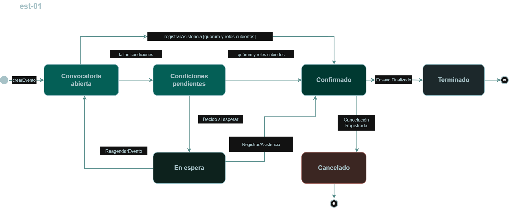
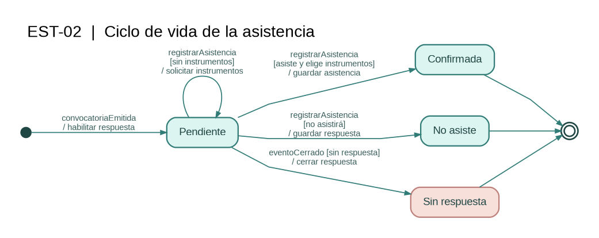

# Diagramas de estado

En esta parte se muestran los cambios de estado de dos elementos de KarismaSync: el evento de ensayo y la asistencia de cada integrante. Los diagramas permiten entender qué pasa con una convocatoria y con las respuestas que recibe.

## EST-01 — Ciclo de vida del evento de ensayo

- **Clase del dominio:** `EventoDeEnsayo` ([modelo de dominio](./08-modelo-dominio.md)).
- **Historias relacionadas:** [HU-01, HU-02, HU-04 y HU-05](./04-historias-usuario.md).
- **Diagramas de secuencia relacionados:** [DSS-01 y DSS-02](./10-diagramas-secuencia.md).

**Archivo fuente (PlantUML):** [est-01.puml](./diagramas/est-01.puml).

El evento comienza cuando el líder crea la convocatoria. Mientras está **Vigente**, puede encontrarse en tres situaciones: **Convocatoria abierta**, **Condiciones pendientes** o **En espera**. Estas situaciones se muestran dentro de Vigente para mantener la relación con el modelo de dominio.

Si se completa el quórum y están cubiertos los roles necesarios, el evento pasa a **Confirmado**. Si todavía falta algo, se avisa al líder para que decida si espera nuevas respuestas o reagenda el ensayo. Una vez confirmado, el evento puede terminar o quedar cancelado.

### Tabla de transiciones — EST-01

| Estado origen | Evento | Guarda | Acción | Estado destino |
|---|---|---|---|---|
| Inicial | `crearEvento` | Líder autorizado | Registrar el ensayo y notificar | Vigente / Convocatoria abierta |
| Convocatoria abierta | `registrarAsistencia` | Falta quórum o algún rol | Avisar al líder | Condiciones pendientes |
| Convocatoria abierta | `registrarAsistencia` | Quórum y roles completos | Bloquear agenda y notificar | Confirmado |
| Condiciones pendientes | `registrarAsistencia` | Quórum y roles completos | Bloquear agenda y notificar | Confirmado |
| Condiciones pendientes | `decidirEsperar` | Decisión del líder | Mantener la convocatoria | En espera |
| En espera | `reagendarEvento` | Decisión del líder | Actualizar fecha y notificar | Convocatoria abierta |
| En espera | `registrarAsistencia` | Quórum y roles completos | Bloquear agenda y notificar | Confirmado |
| Confirmado | `ensayoFinalizado` | — | Cerrar el evento | Terminado |
| Confirmado | `cancelacionRegistrada` | — | Informar cancelación | Cancelado |
| Terminado | Fin del ciclo | — | — | Final |
| Cancelado | Fin del ciclo | — | — | Final |

**Aclaración:** el modelo de dominio define **Vigente** como estado del evento. En este diagrama, *Convocatoria abierta*, *Condiciones pendientes* y *En espera* se usan como subestados para explicar con más detalle lo que ocurre antes de confirmar el ensayo. La Entrega 1 menciona eventos cancelados, pero no especifica el procedimiento de cancelación; por eso se representa con el evento general `cancelacionRegistrada`.

## EST-02 — Ciclo de vida de la asistencia

- **Clase del dominio:** `Asistencia` ([modelo de dominio](./08-modelo-dominio.md)).
- **Historias relacionadas:** [HU-02 y HU-03](./04-historias-usuario.md).
- **Diagrama de secuencia relacionado:** [DSS-02](./10-diagramas-secuencia.md), ya que las respuestas registradas permiten evaluar el ensayo.

**Archivo fuente (PlantUML):** [est-02.puml](./diagramas/est-02.puml).

Cuando se envía la convocatoria, la respuesta del integrante queda **Pendiente**. Si confirma que asistirá, debe seleccionar uno o más instrumentos y su asistencia pasa a **Confirmada**. Si indica que no irá, queda en **No asiste**. Si la convocatoria se cierra sin respuesta, queda en **Sin respuesta**.

### Tabla de transiciones — EST-02

| Estado origen | Evento | Guarda | Acción | Estado destino |
|---|---|---|---|---|
| Inicial | `convocatoriaEmitida` | — | Habilitar la respuesta | Pendiente |
| Pendiente | `registrarAsistencia` | Asistirá y selecciona instrumentos | Guardar asistencia | Confirmada |
| Pendiente | `registrarAsistencia` | Indica que no asistirá | Guardar respuesta | No asiste |
| Pendiente | `registrarAsistencia` | Asistirá, pero no selecciona instrumentos | Solicitar instrumentos | Pendiente |
| Pendiente | `eventoCerrado` | No respondió | Cerrar respuesta | Sin respuesta |
| Confirmada | Fin de la respuesta | — | — | Final |
| No asiste | Fin de la respuesta | — | — | Final |
| Sin respuesta | Fin de la respuesta | — | — | Final |

La asistencia **Confirmada** de un integrante no significa que el ensayo completo esté confirmado. Para eso, el sistema todavía debe comprobar el quórum y los roles requeridos.
